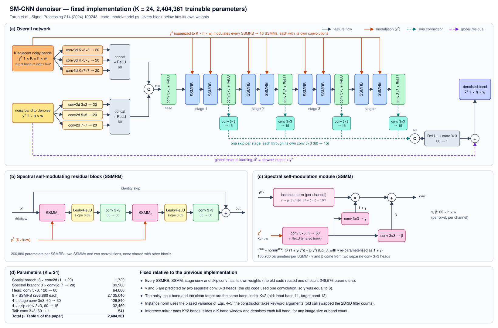

## SM-CNN: Hyperspectral Image Denoising via Self-Modulating Convolutional Neural Networks
[Paper](https://www.sciencedirect.com/science/article/pii/S0165168423003225?via%3Dihub)



### Installation
* Install dependencies:
```bash
pip install -r requirements.txt
```
### Train and Test
* Put your data into the 'datasets' directory
* Open the model directory in terminal and set the python environment (all scripts are run from `model/`)
* Create train and val patches (train cubes `../datasets/WDC/*.mat`, variable `data`; val cube `../datasets/WDC/val/valid.mat`, variable `temp`):
```bash
python get_patches_wdc.py
python get_patches_wdc.py --src_dir ../datasets/WDC/val --key temp --tar_dir ../datasets/WDC/valid --num_patches 128 --seed 1
```
* Create the noisy test cube of a config (clean cube `../datasets/WDC/test/GT_crop.mat`, written to the config's `test_file`):
```bash
python get_patches_wdc_test.py --config-file gauss_blind_config.yaml
```
* Train example (add `--resume` to continue from the last epoch):
```bash
python train.py --config-file gauss_blind_config.yaml
```
* Test example (prints MPSNR / MSSIM / SAM and saves the denoised cube, metrics and a false-color figure to `save_dir`):
```bash
python predict.py --config-file gauss_blind_config.yaml
```
